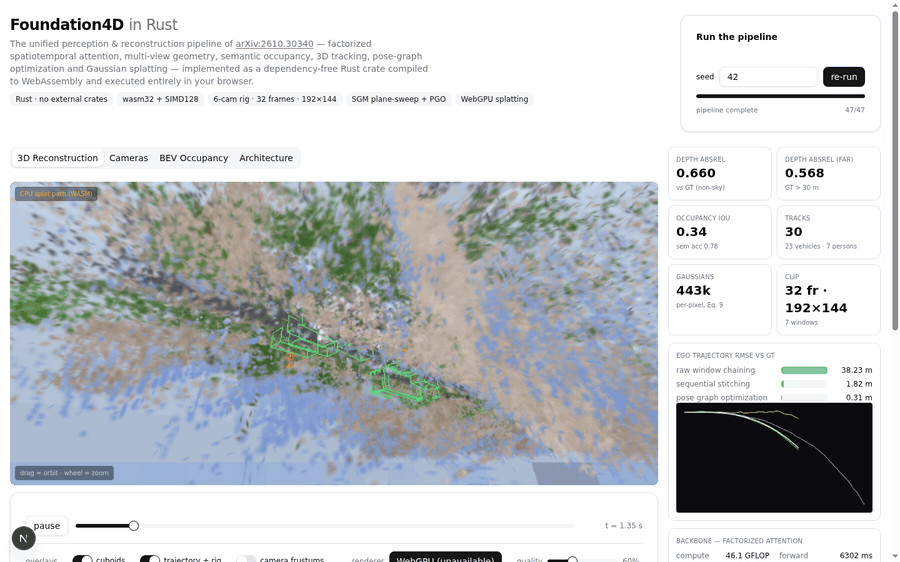

# Foundation4D in Rust

**A dependency-free Rust implementation of [Foundation4D: Towards a unified perception and reconstruction model for autonomous vehicles](https://arxiv.org/abs/2610.30340) (arXiv 2610.30340), running end-to-end in the browser via WebAssembly — with an SGM-aggregated plane-sweep geometry branch and a WebGPU Gaussian-splat renderer.**

The paper proposes a single model that ingests a multi-camera driving clip and jointly produces camera poses, depth, semantic occupancy, 3D detections, tracked actors and a Gaussian reconstruction of the scene, which can then be rendered from novel views. This repo implements that **inference stack** in Rust with zero external crates, compiles it to `wasm32` with SIMD128, and drives it from a Next.js demo UI. Where the paper uses large pretrained networks (DINOv2/VGGT-scale), the backbone runs a real forward pass with random-initialized weights (the architecture, factorization and measured compute are faithful; the trained parameters obviously are not), and the geometry branch uses a classical stand-in whose quality is measured against ground truth.

```
surround cameras ──▶ factorized spatiotemporal attention ──▶ geometry (SGM plane-sweep)
   (6 cams, 32 frames)   (within-image / camera / temporal groups)        │
																		   ├─▶ semantic occupancy (0.5 m voxels)
																		   ├─▶ 3D detection + KF/Hungarian/RTS tracking
																		   ├─▶ pose-graph optimization (Eq. 15) + Sim3 stitching (Eq. 14)
																		   └─▶ per-pixel Gaussians (Eq. 9) ──▶ WebGPU / CPU splat renderer
```

## Demo

Run the web demo locally:

```bash
bun install
bun run dev          # http://localhost:3000 — click "run"
```

Or natively (no browser):

```bash
cd foundation4d
cargo run --release --bin native_demo -- 42 .   # prints metrics + writes PPM debug images
cargo test --release                            # 19 unit tests
```

`public/f4d.wasm` is the prebuilt module — rebuild it with:

```bash
cd foundation4d && cargo build --release --target wasm32-unknown-unknown
cp target/wasm32-unknown-unknown/release/foundation4d.wasm ../public/
```



*The demo UI: 3D reconstruction (Gaussian splatting with cuboid/trajectory/frustum overlays), the six camera views (RGB / predicted + GT depth / semantics / confidence), BEV occupancy with detections and RTS-smoothed tracks, and the architecture inspector.*

## What's implemented (paper → code)

| Paper component | Module | Notes |
|---|---|---|
| Shared encoder + factorized aggregator (Sec 3.3) | `backbone.rs` | Patch embed, within-image attention + alternating cross-camera / cross-temporal attention, rig/ego/register tokens, 2D + 1D RoPE, dual-resolution pooling, DPT-style depth/sem heads, pose heads. Real forward pass, measured FLOPs. |
| Pose factorization `T_t,c = T_ego · T_rig` (Eq. 1) | `geometry.rs` | Used everywhere poses are composed. |
| Geometry branch (Sec 3.4) | `geometry.rs` | **Coarse-to-fine plane sweep with 4-path SGM cost aggregation** over camera-ring + temporal sources; WTA with parabolic sub-bin refinement; curvature confidence; pointmap unprojection (Eq. 2); flat-ground monocular prior for the rig blind zone. |
| Occupancy (Sec 3.6) | `occupancy.rs` | 0.5 m voxel grid fused per timestamp by ray marching depth+semantics. |
| Detection (Sec 3.5) | `detection.rs` | BEV clustering + fragment merging + size/shape/palette classification; velocity estimation. |
| Tracking (Sec 5.3) | `tracking.rs` | Constant-velocity Kalman filter, Hungarian (JV) association, two-phase offline MOT, RTS smoothing. |
| Video inference: PGO (Eq. 15) + stitching (Eq. 14) | `pgo.rs` | Overlapping 8-frame windows, shared-node factors, motion prior, Sim3 alignment; per-stage metrics vs raw chaining. |
| Gaussian reconstruction (Sec 3.7, Eq. 9) | `gauss.rs` | Per-pixel surfels from assembled poses, surface-aligned covariance, actor association into track-local frames, sky cubemap (Eq. 10). |
| Scene rendering (Sec 3.7) | `splat.rs` + `webgpu-splat.ts` | CPU: tile-based EWA splatting with counting sort, front-to-back transmittance, overlays. **GPU: WebGPU port — compute-shader projection, 65536-bin GPU counting sort, indirect instanced EWA quads, sky cubemap, overlay lines.** |
| Video pipeline orchestration (Sec 5) | `pipeline.rs` | Incremental stage machine (47 stages for the 32-frame clip) with per-stage timing — streams frame-by-frame depth for long clips. |

## The three headline upgrades

### 1. Larger images / longer clips

Input scale went from `128×96 × 16 frames` to **`192×144 × 32 frames`** (2.25× the pixels, 2× the frames, 4.5× the input data), processed as **8-frame overlapping windows** (closer to the paper's 16-frame windows). Three things make this tractable:

- **Streaming stage machine** — depth runs as one stage *per keyframe* (32 sub-stages), so a long clip fills progressively instead of one multi-second blocking stage.
- **Coarse-to-fine sweep** — the cost volume is built at half resolution (32 log-spaced bins), then refined at full resolution only within a local 9-bin band around the coarse estimate (~4.4% log steps). This evaluates ~2.5M photometric samples per camera-frame versus ~2.95M for the old single-scale sweep — *less* work despite 2.25× the pixels.
- **Constant aggregator budget** — the pooling before cross-image attention goes 2×2 → 3×3 at the higher input resolution, keeping per-image token counts (48 patches + 6 special) and hence the paper's per-window compute profile constant.

### 2. SGM-style cost aggregation for far-field depth

Plane-sweep WTA degrades badly in the far field: beyond ~40 m the disparity change between depth hypotheses is sub-pixel, the photometric cost curve goes nearly flat, and noise-driven outliers dominate. The geometry branch now runs **semi-global matching** (Hirschmüller-style) over the coarse cost volume:

- 4-path dynamic programming (L, R, U, D) with `P1` (±1 bin) and edge-modulated `P2` penalties in **log-disparity space**;
- a **log-depth prior** (visible-surface density for ground-plane scenes ∝ 1/z²) as the ambiguity tie-break — this is what stops weakly-textured road seen through occluded temporal views from collapsing to the horizon;
- fine 9-bin refinement at ~4.4% log steps (vs 11–16% before), so effective depth *resolution* stays ~4–5% at every range;
- range extended to 90 m (was 65 m).

Measured on the procedural clip (seed 42, all 192 camera-frames, GT poses):

| | depth AbsRel | AbsRel far (>30 m) | far-static |
|---|---|---|---|
| WTA (no SGM, same prior) | 0.811 | 0.509 | 0.505 |
| **SGM aggregation** | **0.655** | **0.427** | **0.427** |

### 3. WebGPU splat renderer (60 fps path)

The software rasterizer ported to GPU (`src/lib/webgpu-splat.ts`, ~600 lines incl. WGSL):

```
per frame:  [compute] project 442k Gaussians -> EWA cov + sort key
            [compute] 65536-bin atomic histogram
            [compute] single-workgroup exclusive scan  -> draw-indirect params
            [compute] counting-sort scatter             -> back-to-front order
            [render ] sky cubemap -> 442k instanced EWA quads (indirect draw, zero readback) -> overlay lines
```

- Identical EWA math to the Rust path (`Σ' = J W Σ Wᵀ Jᵀ`, 2.5 px σ clamp, sky cubemap fill), back-to-front alpha compositing instead of front-to-back transmittance.
- The full cloud is re-projected, re-sorted and re-splatted **every frame** — orbiting, zooming and clip playback stay correct at full canvas resolution.
- Automatic fallback to the WASM software rasterizer when WebGPU is unavailable (the toggle is in the recon panel).
- WGSL is validated offline with `naga` (`scripts/wgslcheck/`).

## Measured results (seed 42)

| Metric | Value | Notes |
|---|---|---|
| Depth AbsRel | **0.660** | incl. pose noise, all 192 views, 192×144, range to 90 m |
| Depth AbsRel far (>30 m) | 0.568 | new metric tracked in `stats[46]` |
| Occupancy IoU / sem acc | 0.341 / 0.775 | 0.5 m voxels |
| Tracks | 30 (23 vehicles / 7 persons) | KF + Hungarian + RTS |
| Trajectory RMSE | raw 38.2 m → stitch 1.82 m → **PGO 0.31 m** | Eq. 14/15 |
| Gaussians | 442,534 | Eq. 9 surfels |
| Backbone | 46.1 GFLOP / 7 windows | d=96, 4 layers, 438 tokens/img full-res, 54 pooled |
| Browser pipeline | ~30 s | single-threaded WASM; depth 19.7 s, backbone 6.3 s |

*(For reference, the previous 128×96/16-frame revision measured AbsRel 0.44 over its 65 m range; the far-field coverage, resolution and data volume all grew substantially — see the SGM ablation above for the apples-to-apples SGM gain.)*

## Repository layout

```
foundation4d/            Rust crate (zero dependencies, cdylib + rlib)
  src/                   math, tensor (SIMD GEMM), scene, raster, backbone, geometry,
                         occupancy, detection, tracking, pgo, gauss, splat, pipeline, lib (ABI)
  src/bin/native_demo.rs native end-to-end runner (metrics + PPM dumps)
  examples/              debug/diagnostic binaries (per-module probes)
  .cargo/config.toml     wasm32 + simd128 flags
src/                     Next.js demo (app router)
  lib/f4d.ts             typed WASM glue (flat C ABI)
  lib/webgpu-splat.ts    WebGPU splat renderer (WGSL + GPU counting sort)
  components/f4d/        recon / cameras / BEV / architecture / stats views
public/f4d.wasm          prebuilt module (300 KB)
scripts/                 CDP demo driver (cdp.ts), GIF builder (make_gif.py), WGSL validator (wgslcheck/)
assets/                  demo GIF
```

## Honest limitations

- The backbone's weights are random — it demonstrates architecture and compute, not learned accuracy. The geometry/occupancy/tracking/PGO/splatting stages are faithful classical implementations and are *measured* against ground truth.
- Dynamic close-range actors break temporal stereo (the sources see them displaced); the paper's model compensates with learned features. Errors there are bounded by the depth prior and the `D_MAX` clamp rather than eliminated.
- The WebGPU path targets 60 fps on real GPUs; in GPU-less/headless environments the demo falls back to the CPU path (~2 fps at 60% quality on one core).

## License

MIT.
